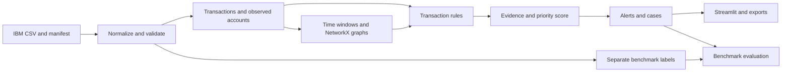

# FinTrace

An explainable suspicious-transaction and potential money-mule investigation project using IBM's synthetic AML banking benchmark.

**Status: data preparation and six deterministic transaction rules are implemented, with evidence-backed cutoff snapshots. Temporal NetworkX graphs and bounded PNG views are implemented. Fixed-policy priorities and persistent audited alerts are implemented. The Streamlit overview, alert review, account evidence and interactive network screens are implemented. Versioned cases, verified local reports and checkpointed historical replay are implemented. Benchmark evaluation remains pending.** See [the data workflow](data/README.md) and [rule workflow](docs/features/transaction_rules/README.md) for working commands.

The agreed scope uses deterministic transaction rules, historical comparisons, NetworkX graph algorithms, transparent priority scoring, and investigator review. Machine learning, fitted classifiers, learned embeddings, and generated explanations are excluded.

## Dataset

Start with the **HI-Small** transaction file from [IBM Transactions for Anti Money Laundering](https://www.kaggle.com/datasets/ealtman2019/ibm-transactions-for-anti-money-laundering-aml), linked by the [IBM AML-Data repository](https://github.com/IBM/AML-Data). IBM states that the transactions are fully synthetic. Do not describe them as actual bank records.

Download separately into `data/raw/ibm/`; this scaffold does not download or redistribute dataset files. Record the file hash, variant, source URL, acquisition date, source terms, and timestamp interpretation before ingestion. IBM identifies the dataset license as **CDLA-Sharing-1.0**, separately from its repository's code license. Record the terms of the exact copy obtained.

The standard transaction export contains two source columns called `Account`. Resolve them by verified position, not a blind name-based rename. Preserve account and bank identifiers as strings. Use the pair `(bank_id, account_id)` as an account identity.

The transaction export does not supply verified customer identities, account opening dates, devices, IP addresses, ownership, expected income, or sanctions identities. A separately supplied accounts export can contain synthetic entity IDs/names. Preserve it separately and report explicit account-link candidates; source entity names are not independently verified KYC. Derive the observed account registry from transfer endpoints and mark missing context explicitly.

## Features and availability

Implemented now: data preparation, deterministic rules, bounded temporal graphs, fixed-policy priorities, audited alerts, snapshot account/network investigation, versioned cases, local evidence exports, checkpointed historical replay and the seven-page Streamlit workspace. Benchmark evaluation and optional context/screening services remain pending; IBM-only support in the table describes data feasibility, not implementation status. Full-history account queries and complete-history-dependent rules are unavailable without the required implementation or declared coverage.

| Feature | Functionality | Inputs | Outputs | IBM-only support |
| --- | --- | --- | --- | --- |
| [Ingestion](docs/features/ingestion/README.md) | Normalize and preserve source lineage | IBM CSV, dataset manifest | Transactions, observed accounts, separate benchmark labels | Yes |
| [Validation](docs/features/validation/README.md) | Check schema, amounts, timestamps, identifiers and duplicates | Normalized batches, schema policy | Accepted rows, quarantine, quality report | Yes |
| [Transaction rules](docs/features/transaction_rules/README.md) | Pass-through, collection/dispersal, bursts, dormancy, repeated splitting | Valid transactions, historical windows, rule configuration | Findings with transaction evidence | Yes, subject to observed history |
| [Temporal graphs](docs/features/temporal_graphs/README.md) | Ordered chains, bounded cycles, coordinated groups and account relationships | Windowed transactions | Graphs, paths, cycles, group evidence | Yes |
| [Entity context](docs/features/entity_context/README.md) | Shared identifiers, customer mismatch, source/destination context | Optional independently sourced context | Context findings or explicit unavailability | Partial; most enrichment absent |
| [Priority scoring](docs/features/priority_scoring/README.md) | Add capped, auditable rule contributions | Findings, scoring policy | 0–100 priority and contribution breakdown | Yes |
| [Alerts](docs/features/alerts/README.md) | Deduplicate findings into reviewable alerts | Findings, scores, prior alerts | Alert queue and lifecycle events | Yes |
| [Account investigation](docs/features/account_investigation/README.md) | Explain behaviour and supporting transfers | Account key, time range, evidence | Account dossier and timeline | Yes |
| [Network investigation](docs/features/network_investigation/README.md) | Explore directed transaction neighbourhoods | Seed account or alert, graph limits | Interactive view and graph export | Yes |
| [Cases](docs/features/cases/README.md) | Group alerts, record review and maintain audit history | Alerts, investigator actions | Cases, notes, status history | Yes |
| [Reports](docs/features/reporting/README.md) | Export evidence and deterministic explanations | Case/alert snapshot | CSV, JSON, HTML and PNG artifacts | Yes |
| [Evaluation](docs/features/evaluation/README.md) | Measure rule coverage and alert usefulness against benchmark labels | Frozen detections, separately stored labels | Precision/recall, coverage and review-budget metrics | Yes; labels concern laundering, not confirmed mules |
| [Replay](docs/features/replay/README.md) | Process transaction events chronologically | Valid transactions, replay policy | Incremental findings, alerts and replay checkpoints | Yes; historical replay |
| [Screening](docs/features/screening/README.md) | Optional reference-list candidate matching | Entity identities, dated reference lists | Review candidates and exact match evidence | Disabled without additional data |
| [Dashboard](docs/features/dashboard/README.md) | Overview, queue, account/network, cases, reports and replay | Service read models | Streamlit investigation screens | Core views implemented |

Rules, defaults, limitations, function contracts, and acceptance examples are detailed in the linked feature specifications. Every project directory contains an `AGENTS.md` describing its purpose, inputs, outputs, functionality, and implementation constraints.

## Repository layout

```text
FinTrace/
├── AGENTS.md                     # Project-wide implementation instructions
├── README.md
├── pyproject.toml                # Dependencies and package metadata
├── app/                          # Streamlit entry point, pages and UI components
├── config/                       # TOML application, detection and scoring policies
├── data/
│   ├── raw/ibm/                  # Locally acquired immutable source files
│   ├── processed/                # Normalized transactions and derived evidence
│   └── reference/                # Optional verified context and reference lists
├── docs/
│   ├── architecture.md
│   ├── data_contracts.md
│   ├── roadmap.md
│   ├── dataset.md
│   └── features/                 # One contract directory per feature
├── outputs/                      # Local reports and exported graph artifacts
├── scripts/                      # Scaffold verification and future operational tools
├── src/fintrace/
│   ├── contracts.py
│   ├── pipeline.py
│   ├── ingestion/
│   ├── validation/
│   ├── rules/
│   ├── graph/
│   ├── context/
│   ├── scoring/
│   ├── alerts/
│   ├── investigations/
│   ├── cases/
│   ├── reporting/
│   ├── evaluation/
│   ├── replay/
│   ├── screening/
│   └── storage/
└── tests/
    ├── unit/
    ├── integration/
    └── fixtures/
```

Each listed directory also contains its own `AGENTS.md`; these files are omitted from the tree for readability.

## Planned data flow



Labels and benchmark pattern annotations are evaluation inputs only. They must never influence detection, graph construction, scoring, prioritization, or ordinary investigation screens.

## Local setup

Requires Python 3.11 or newer. The data/graph environment is pinned in config/data-requirements.txt.

```bash
python3 -m venv .venv
source .venv/bin/activate
python -m pip install -e '.[dev]'
python scripts/check_scaffold.py
streamlit run app/streamlit_app.py
```

The Streamlit command opens the investigation workspace; a missing store shows setup instructions. `python3 scripts/prepare_data.py --help` lists data commands. Audit/create/verify require only the standard library; ingest/accounts and the rule runner use the pinned data environment in config/data-requirements.txt.

Run a deterministic snapshot on the prepared local dataset:

```bash
.venv/bin/python scripts/run_rules.py \
  data/processed/datasets/ibm-d09512cc782ac4059163288737a35b3a948ab93d31888fb8da9c6c342b86cde4/transactions.parquet \
  --cutoff 2022-09-02T12:00:00Z
```

Findings and feature coverage are written under data/processed/rule_runs/<run_id>/. Each rule uses its own configured interval ending at the exclusive cutoff. Input overflow fails instead of sampling. History-dependent rules remain unavailable when observation coverage is unknown. See [the checked rule snapshot](docs/rule_validation.md) for measured results and limits.

Core libraries: Pandas, NetworkX, Matplotlib, Streamlit, DuckDB, PyArrow and PyVis. Pytest is reserved for implementation verification. TOML is read with the Python standard library.

The uploaded HI-Small snapshot has been fully processed and verified: 5,078,345 accepted transactions, 515,088 observed account keys, and zero quarantined financial rows. See [the checked dataset report](docs/data_validation.md) for checksums, label isolation, identifier reconciliation, explicit provenance assumptions and repeatable verification commands. The separately supplied HI-Medium files use the same importer and policies; see [the HI-Medium report](docs/hi_medium_validation.md) and [import workflow](data/README.md#selecting-hi-medium).

## Detection and explanation principles

- Findings indicate patterns warranting review; they do not establish criminal intent or a confirmed mule identity.
- Time-respecting paths require ordered transfers; structural reachability alone does not establish money movement.
- Pass-through attribution uses a declared allocation method and cannot establish exact provenance through commingled funds.
- Compare and aggregate amounts within a currency. Cross-currency value comparisons require dated conversion data and explicit policy.
- Use fixed-precision amounts; preserve timestamp precision and declared timezone assumptions.
- Separate observed inactivity from verified account dormancy and verified account age.
- Optional inputs missing from IBM must remain unavailable; do not invent customer records.
- All thresholds are demonstration policy, not reporting obligations. No automated account blocking or regulatory filing.
- Every finding and score must include source transaction references, policy versions, time windows and limitations.
- Partial graph searches, truncated displays and insufficient history must be visible.

## Next implementation work

Bounded temporal NetworkX analysis is implemented: chronological paths, circular flows, synchronized groups and descriptive graph context. Fixed-policy priority and local audited alert services are also implemented. The Streamlit overview, alert review and bounded account/network views are implemented. Versioned case workflow, local evidence reports and historical replay are implemented; full-history account queries and benchmark evaluation remain in [the roadmap](docs/roadmap.md). Optional enrichment requires suitable independent inputs.

Run the verified NetworkX snapshot and bounded PNG export:

```bash
.venv/bin/python scripts/run_graphs.py \
  data/processed/datasets/ibm-d09512cc782ac4059163288737a35b3a948ab93d31888fb8da9c6c342b86cde4/transactions.parquet \
  --cutoff 2022-09-02T12:00:00Z
```

See [the graph workflow](docs/features/temporal_graphs/README.md) for seed scope, evidence, graph limits and artifact locations.

Import matching frozen rule and graph snapshots into local review alerts:

```bash
.venv/bin/python scripts/manage_alerts.py import \
  --rules-run data/processed/rule_runs/RULE_RUN_ID \
  --graph-run data/processed/graph_runs/GRAPH_RUN_ID \
  --actor local-investigator --at 2026-10-16T12:00:00+05:30
.venv/bin/python scripts/manage_alerts.py list
```

Replace run IDs and action time with actual values. See [the alert workflow](docs/features/alerts/README.md) for persistence, priority ledgers and audited state changes, and [checked results](docs/priority_alert_validation.md) for the verified IBM snapshot.

## Investigation workspace

```bash
.venv/bin/python -m pip install -r config/frontend-requirements.txt
.venv/bin/python -m streamlit run app/streamlit_app.py
```

Open the local URL printed by Streamlit (normally http://localhost:8501). The existing local alert store is discovered automatically. Choose a snapshot, filter the review queue, inspect contribution/evidence details, load account transfers, or explore a bounded interactive NetworkX/PyVis graph. Reviewer actions require an explicit form submission and reason. Missing data shows setup instructions. See [dashboard workflow](docs/features/dashboard/README.md) and [frontend validation](docs/frontend_validation.md). This local workspace has no authentication or public deployment configuration.


## Cases, reports and historical replay

The workspace sidebar includes Cases, Reports and Replay. Cases retain versioned frozen evidence and explicit audited actions. Reports produce verified local JSON/CSV/HTML/PNG artifacts and a download ZIP. Replay advances ordered exclusive cutoffs into an isolated alert store with checkpoint/resume; it leaves the ordinary queue unchanged.

CLI entry points are `scripts/manage_cases.py`, `scripts/export_reports.py` and `scripts/run_replay.py`; each supports `--help`. See [workflow service verification](docs/workflow_services_validation.md) for the measured HI-Medium checks, fixtures and remaining limitations. No source datasets or generated reports/checkpoints are committed.
