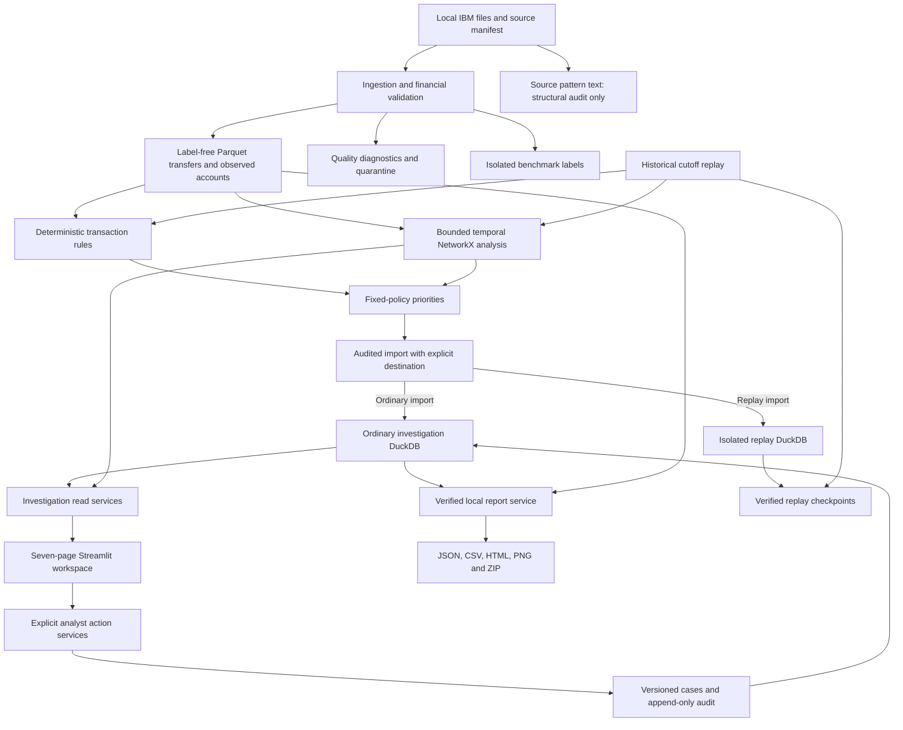

# FinTrace

**An explainable transaction investigation workspace built with explicit rules, temporal graphs and human review.**

FinTrace helps a reviewer move from a suspicious transfer pattern to the accounts, transactions, policy thresholds and source records behind it. It uses IBM's fully synthetic AML transaction data and runs locally with a Streamlit dashboard, NetworkX analysis, Parquet datasets and DuckDB persistence.

The implemented workflow covers data preparation, validation, transaction rules, temporal graphs, review priorities, audited alerts, account and network investigation, cases, evidence exports and historical replay. **No machine learning, fitted predictors, embeddings or generated investigation narratives are used.**

## Contents

- [The problem we are tackling](#the-problem-we-are-tackling)
- [Where FinTrace is helpful](#where-fintrace-is-helpful)
- [Main technical challenges](#main-technical-challenges)
- [Implemented services and features](#implemented-services-and-features)
- [Rules, graphs and review priorities](#rules-graphs-and-review-priorities)
- [System architecture](#system-architecture)
- [Dashboard and investigation workflow](#dashboard-and-investigation-workflow)
- [Dataset and evidence boundaries](#dataset-and-evidence-boundaries)
- [Local setup](#local-setup)
- [Running the services](#running-the-services)
- [Configuration and operating limits](#configuration-and-operating-limits)
- [Verification](#verification)
- [Scope and limitations](#scope-and-limitations)
- [Repository layout and documentation](#repository-layout-and-documentation)

## The problem we are tackling

A transfer viewed on its own provides limited context. An account might receive payments from several senders, forward much of the observed inflow shortly afterwards, split payments across recipients, or appear inside a longer chain of transfers. Understanding that behaviour requires looking across accounts and time while preserving the individual records behind the pattern.

The investigation problem has several connected parts:

1. **Find patterns across transfers.** Identify collection, dispersal, forwarding and chronological connections that deserve review.
2. **Explain why they were selected.** Show the measured behaviour, configured threshold, time window, currency and supporting transaction IDs.
3. **Help reviewers choose where to start.** Organize overlapping findings into a manageable queue with transparent policy contributions.
4. **Preserve the investigation.** Retain reviewed evidence, notes, decisions, report artifacts and an audit trail that can be checked later.

FinTrace brings these steps into one local workspace. It is designed to support investigation of suspicious transfer behaviour and potential intermediary-account activity. A finding is a reason to examine the evidence; it does not establish that an account is a money mule or that a transaction is criminal.

### An illustrative example

Suppose an account receives three same-currency payments of 100 each, then sends 250 to another account at a strictly later time within the configured window. A pass-through finding can record the three incoming transfers, the outgoing transfer, an observed-inflow denominator of 300 and a FIFO-allocated forwarded amount of 250.

The reviewer can inspect those exact records and compare the measured forwarding ratio with the configured threshold. The calculation describes an allocation of observed inflows; it does not prove the exact origin of the outgoing funds. Reversing the transfer order, changing currencies or lacking the required evidence changes what the rule can support. This is a handcrafted example, not a measured IBM case.

## Where FinTrace is helpful

| Use | How the project helps |
| --- | --- |
| Analyst training and demonstrations | Synthetic data supports practice with alert review, evidence inspection, case notes and audit history. |
| Investigation workflow prototyping | Demonstrates the complete path from prepared records to an internal evidence report. |
| Rule and policy review | Makes thresholds, family weights, suppressed contributions and coverage limitations visible. |
| Temporal graph exploration | Lets reviewers distinguish a structural connection from a transfer sequence that actually respects time. |
| Engineering verification | Provides reproducible datasets, immutable snapshots, source hashes and fixtures for financial and workflow boundaries. |
| Historical demonstrations | Replays the same deterministic services at earlier cutoffs with isolated alerts and resumable progress. |

These are uses of the implemented local research and investigation workspace. Connecting it to a real institution would require separate work on access control, source integration, independent context, operational controls and institution-specific policy review.

## Main technical challenges

| Challenge | FinTrace's approach | Why it matters |
| --- | --- | --- |
| Large transaction files | Stream validated records into Parquet; partition larger account/duplicate summaries; keep analysis windows and graph searches bounded. | Full-file preparation should not require building one enormous in-memory graph. |
| Exact financial values | Use decimal(38,8) normalized amounts and Decimal arithmetic; retain paid/received values and currencies separately. | Floating-point rounding or implicit currency conversion can change the evidence. |
| Account identity and lineage | Preserve exact `(bank_id, account_id)` strings and dataset/file/record identity. | Similar account strings at different banks and identical-valued payments must remain distinct. |
| Chronological evidence | Apply exclusive cutoffs and require strictly increasing times for temporal paths. | A later transfer cannot explain an earlier one; tied source timestamps do not establish transfer order. |
| Incomplete history | Record declared observation intervals and gaps; mark unsupported historical comparisons unavailable. | First appearance in a file is not proof of account opening or reactivation. |
| Overlapping indicators | Group related findings into fixed scoring families and disclose suppressed contributions. | Several descriptions of related behaviour should not silently inflate review priority. |
| Dense visual networks | Bound rendered scope, reserve ranked accounts, separate connected groups and use fixed layouts with readable zoom and full-screen controls. | Reviewers need navigable evidence rather than an unstable, crowded graph. |
| Reproducible review | Verify hashes, retain immutable evidence/case versions and append audit events transactionally. | Later updates should not silently rewrite what a reviewer previously saw. |
| Benchmark-label leakage | Physically separate labels and pattern annotations from detection-facing records. | Detectors and priorities must not use the supplied answer labels. |

## Implemented services and features

These are local Python services exposed through CLI commands and/or dashboard pages. They are separate domain modules, not a collection of independently deployed web microservices.

| Service | Main inputs | Implemented behaviour and outputs |
| --- | --- | --- |
| Source audit and provenance | Locally supplied IBM CSVs, optional account/pattern files, explicit source metadata | Positional-header checks, source hashes, structural audits and immutable versioned manifests. |
| Ingestion and validation | Verified manifest, financial fields, declared timezone and precision | Normalized transfers, observed accounts, quarantine, quality diagnostics and isolated label artifacts. |
| Publisher-account reconciliation | Separately supplied synthetic account table and observed account keys | Preserved publisher records and explicit exact/zero-padding/ambiguous/unmatched link candidates. |
| Transaction rules | Label-free transfers, rule policy, cutoff and declared history coverage | Six deterministic rules, evidence-backed findings and per-rule coverage. |
| Temporal graph analysis | Bounded transfer window, graph policy and optional seed accounts | Directed transaction graph, ordered paths/cycles, coordinated-group findings, descriptive metrics and PNG artifacts. |
| Review priority | Eligible findings, coverage and fixed scoring policy | A capped 0–100 review priority with family-level contributions and correlated-evidence suppression. |
| Alert lifecycle | Verified snapshots, priorities and explicit reviewer actions | Persistent deduplicated alerts, retained evidence and version-checked append-only review events. |
| Account investigation | Exact account key, selected snapshot and optional linked graph | Subject findings, priorities, linked alerts, observed graph-window transfers and exact currency totals. |
| Network investigation | Verified graph, ranked alert subjects or one account, display limits | Combined top-ten alerted-account view, bounded neighbourhoods, transfer details and evidence highlighting. |
| Case workflow | Snapshot alerts and explicit analyst actions | Frozen evidence attachments, assignment, append-only notes, closure/reopen, immutable versions and audit history. |
| Evidence reporting | Snapshot/alert selection or a case version, verified financial sources | Local JSON, CSV, escaped HTML, bounded PNG, checksummed manifests and verified ZIP downloads. |
| Historical replay | Completed dataset, fixed policies, ordered cutoffs and optional checkpoint | Repeated batch analysis, replay-local alerts, counts, artifact references and verified checkpoint/resume. |
| Investigation dashboard | Service read models and explicit form/button submissions | Seven dark-themed Streamlit pages covering the complete implemented workflow. |
| Storage and integrity | Normalized files, immutable snapshots and versioned workflow records | Parquet financial artifacts, transactional DuckDB alerts/cases and integrity-checked run/checkpoint metadata. |

Detailed callable interfaces, limits and error behaviour are maintained in [the service contracts](docs/services.md). Shared record definitions are in [the data contracts](docs/data_contracts.md).

## Rules, graphs and review priorities

### Six transaction rules

| Rule | What it measures | Evidence boundary |
| --- | --- | --- |
| Observed pass-through | Eligible observed inflow forwarded within the configured interval. | Uses explicit FIFO allocation, compatible currency and strictly later outflows; no double allocation within one account/window. |
| Fan-in | Collection from a configured number of distinct sending accounts. | Distinctness uses the exact bank/account pair, not payment count alone. |
| Fan-out | Dispersal to a configured number of distinct receiving accounts. | Preserves separate payments and exact recipient identities. |
| Repeated splitting | Repeated directed payments meeting an explicit count condition. | Does not infer a legal reporting threshold or intentional evasion. |
| Burst | Current transaction frequency compared with eligible complete historical windows. | Excludes the active window from the baseline; missing or zero baselines remain unavailable. |
| Dormant activation | Renewed activity following a sufficiently observed inactive period. | Requires declared historical coverage; a first-seen account is insufficient. |

Each finding retains its subjects and roles, transaction IDs, measurements, thresholds, currency, interval, cutoff, policy identity and limitations. Coverage distinguishes **evaluated**, **disabled**, **unavailable** and **truncated** results. No findings under unavailable coverage is not a clean-account determination.

### Temporal graphs

Every transfer remains a separate directed edge in a NetworkX MultiDiGraph, including parallel transfers. Separate currency-specific summaries support descriptive analysis.

The graph services implement strictly chronological chains, bounded circular-flow searches and explicit repeated coordination patterns. Strongly connected components narrow cycle candidates, but returned temporal evidence must still satisfy transaction ordering. Communities and centrality are descriptive context; they do not independently create an alert.

The explorer's six structural neighbourhood hops are a **display setting**. They do not change detector path policies or turn ordinary reachability into a temporal money-flow claim.

### Fixed-policy priority

Priority points come from the versioned scoring policy. The current demonstration families are:

| Family | Maximum contribution |
| --- | ---: |
| Observed pass-through | 25 |
| Collection/dispersal/repeated payments | 15 |
| Temporal layering/circular flow | 30 |
| Historical activity change | 15 |
| Coordinated groups | 15 |

Related rules share a family. The ledger shows eligible evidence, selected contributions and suppressed correlated findings. The total is capped at 100. A score of 80 means a configured review priority, not an 80% probability of wrongdoing. Weights and thresholds are explicit demonstration policy, not fitted parameters or legal requirements.

## System architecture



The label and annotation branches have no connection to detectors, priorities, investigation pages, reports or replay. Ordinary imports and replay imports use separate DuckDB destinations. No benchmark metric service is currently maintained.

### Layer responsibilities

- **Preparation:** verify source identity, validate financial fields and publish completed artifacts atomically. Preserve original lineage and quarantine invalid rows.
- **Analysis:** load verified financial snapshots, apply explicit policies and publish immutable rule/graph outputs with hashes and coverage.
- **Priority and workflow:** combine compatible frozen outputs, calculate policy contributions and persist idempotent incidents and audited actions.
- **Investigation and presentation:** build read-only snapshot-scoped models; Streamlit renders them and submits explicit user actions to services.
- **Reports and replay:** resolve verified source evidence for exports, or reuse the existing bounded services at successive historical cutoffs.

Business logic belongs in `src/fintrace`. UI code does not calculate its own detectors or join benchmark labels. Operational scripts call the separate services explicitly; there is no maintained general-purpose pipeline orchestrator.

### Technology stack

| Technology | Role |
| --- | --- |
| Python | Domain contracts, policies, service implementation and CLI commands. |
| PyArrow / Parquet | Typed financial datasets and batch scanning. |
| DuckDB | Local queries, bounded summaries and transactional alert/case persistence. |
| Decimal | Exact monetary arithmetic and currency-separated totals. |
| NetworkX | Directed transaction structures, temporal searches, descriptive algorithms and fixed display layouts. |
| Streamlit / PyVis | Investigation pages and interactive directed graph rendering. |
| Matplotlib | Bounded graph PNG artifacts. |
| Pandas | Tabular data handling and presentation support. |
| TOML / JSON / SHA-256 | Versioned policy, manifests, artifact identities and integrity verification. |
| Pytest / Streamlit AppTest | Synthetic service, boundary, persistence and UI regression checks. |

See [architecture details](docs/architecture.md) for storage, timing and dependency boundaries.

## Dashboard and investigation workflow

| Page | What the reviewer can do |
| --- | --- |
| Overview | Inspect the selected snapshot's account, alert and finding counts, family contributions and coverage. |
| Alert review | Filter the queue, open evidence, inspect the priority ledger and submit version-checked review transitions. |
| Account evidence | Read subject findings, linked alerts and graph-window transfers with exact separate-currency totals. |
| Network explorer | Explore ranked accounts together or one account, inspect directed transfers and highlight finding evidence. |
| Cases | Group frozen alert evidence, assign work, append notes and retain case history and dispositions. |
| Reports | Generate and download verified local artifacts for a snapshot, alert scope or case version. |
| Replay | Start or resume an isolated historical run and inspect completed cutoff progress. |

A typical review starts with an Overview snapshot, continues through an alert's exact evidence and account/network context, and finishes with an explicit review action or case attachment. A report can preserve that selected evidence for internal review.

### Network explorer behaviour

The default combined view starts from the **ten highest-priority distinct accounts with active alerts**. It expands observed neighbourhoods with defaults of **six hops**, **up to 100 accounts** and **150 transfers**. The top ten are starting subjects; the other displayed nodes are observed counterparties. Smaller neighbourhoods may contain fewer accounts.

Orange nodes identify ranked subjects; teal nodes identify counterparties. The ranking table and tooltips show priority and active-alert counts. Missing-window subjects remain explicitly marked isolated nodes, rather than receiving invented transfers.

Connected groups are spaced separately, node positions remain fixed without browser physics, and transfer arrows are enlarged. The default **Readable view** starts zoomed in around the highest-ranked subject. Pan or zoom to inspect the loaded selection, choose **Fit graph** for the whole overview, or use **Full screen** for more space. **Exit full screen** and **Esc** return to the normal view. Single-account mode retains exact finding highlights and transfer references.

### Audit behaviour

Browsing and rerendering do not create cases, submit review decisions, generate reports or advance replay. Writes require explicit actions. Alert/case updates enforce expected versions; cases retain immutable versions and idempotent request responses. Closing records a reason or disposition, and reopening is a separate audited action.

Selected financial evidence remains tied to its snapshot cutoff. Current workflow state can postdate that cutoff and is identified separately. A case attachment freezes the selected evidence so later alerts cannot silently change the original case version.

## Dataset and evidence boundaries

The project uses locally supplied IBM synthetic AML transactions. Source datasets are acquired separately and are not downloaded or committed by the application. Existing local HI-Small and HI-Medium datasets remain separate versions.

The source transaction export includes two columns named `Account`; ingestion resolves them by verified position. A normalized account key always preserves separate bank and account strings. Duplicate-valued payments retain separate source-row identities. Financial values use decimal(38,8), and original timestamp text/precision remain available alongside normalized instants.

Timezone interpretation must be declared. UTC in the existing manifests is an explicit project convention, not a publisher timezone claim. Unknown acquisition time, observation coverage and gaps must remain explicit.

Separately supplied publisher account records are synthetic metadata. Reconciliation may expose zero-padding link candidates, but it does not rewrite detection identities or establish verified customer ownership. Customer opening dates, income, devices, IP addresses and independently verified identities are not inferred from transfers.

### Recorded HI-Medium verification

| Measure | Recorded result |
| --- | ---: |
| Accepted financial transfers | 31,898,238 |
| Observed exact bank/account keys | 2,077,023 |
| Quarantined financial rows | 0 |
| Findings at the selected demonstration cutoff | 280 |
| Scored accounts at that cutoff | 269 |
| Review alerts at that cutoff | 270 |

The snapshot cutoff is `2022-09-03T06:00:00Z`. The full source file was ingested, while detection used bounded policy windows. These numbers describe local validation and review workload, not detection accuracy, confirmed criminal accounts or complete-history analysis. The imported benchmark labels and pattern text remain isolated from the investigation workflow.

Checksums, dataset/run identities, historical HI-Small results and measured limitations are recorded in [local validation](docs/validation.md).

## Local setup

The package declares **Python 3.11 or newer**. Create a virtual environment from the repository root, or activate the existing `.venv`:

```bash
python3 -m venv .venv
source .venv/bin/activate
python -m pip install -e '.[dev]'
python -m streamlit run app/streamlit_app.py
```

The repository also records a verified Python 3.14/Linux environment in [frontend requirements](config/frontend-requirements.txt), extending [data requirements](config/data-requirements.txt). To reproduce that environment, install the frontend requirements before the editable package. Browser automation tools are optional and are not required to use the dashboard.

Streamlit normally uses port 8501. To select another local port:

```bash
python -m streamlit run app/streamlit_app.py --server.port 8507
```

The dashboard needs a prepared local dataset and imported analysis snapshots. An absent/empty alert store displays setup guidance rather than fabricated metrics. A new clone does not include the ignored source data or generated database.

| Environment variable | Default | Purpose |
| --- | --- | --- |
| `FINTRACE_PROCESSED_ROOT` | `data/processed` | Completed datasets and linked analysis artifacts. |
| `FINTRACE_ALERT_DATABASE` | `<processed root>/alerts.duckdb` | Ordinary investigation alert/case store. |
| `FINTRACE_EXPORT_ROOT` | `outputs` | Local report destination. |

## Running the services

Run the commands below from the repository root with the environment activated. Replace uppercase path/ID placeholders with actual service outputs. `AUDIT_TIME_WITH_OFFSET` means the actual audit instant in ISO format with a timezone offset; reviewer/operator fields must identify the person performing the action.

### 1. Audit, manifest and ingest

Place locally acquired source files under `data/raw/ibm/`. An audit inspects uploads without making a provenance declaration:

```bash
python scripts/prepare_data.py audit \
  --transactions HI-Medium_Trans.csv \
  --accounts HI-Medium_accounts.csv
```

If the pattern file is supplied, add `--patterns HI-Medium_Pattern.txt` for structural auditing only. For a new source without a manifest, use `python scripts/prepare_data.py create --help` and declare the actual source terms, variant, timestamp precision and timezone policy. Do not overwrite an existing manifest or invent historical coverage/acquisition metadata.

For the existing HI-Medium manifest:

```bash
python scripts/prepare_data.py verify data/raw/ibm/manifest-hi-medium.json
python scripts/prepare_data.py ingest data/raw/ibm/manifest-hi-medium.json
```

Ingestion returns the dataset identity and completed artifact inventory. Verified repeat imports reuse the completed version. Optional publisher-account reconciliation is separate:

```bash
python scripts/prepare_data.py accounts \
  data/processed/datasets/DATASET_ID/accounts.parquet \
  --source HI-Medium_accounts.csv
```

### 2. Produce rule and graph snapshots

Use only the completed detection-facing `transactions.parquet`:

```bash
python scripts/run_rules.py \
  data/processed/datasets/DATASET_ID/transactions.parquet \
  --cutoff 2022-09-03T06:00:00Z

python scripts/run_graphs.py \
  data/processed/datasets/DATASET_ID/transactions.parquet \
  --cutoff 2022-09-03T06:00:00Z
```

Each command returns its completed run directory. Cutoffs are exclusive and timezone-aware. Findings include coverage and artifact identities. Input overflow fails without sampling. History-dependent rules remain unavailable when complete observation coverage is unknown.

### 3. Import priorities and alerts

Import compatible rule/graph runs from the same dataset, source hashes and cutoff:

```bash
python scripts/manage_alerts.py import \
  --rules-run RULE_RUN_DIRECTORY \
  --graph-run GRAPH_RUN_DIRECTORY \
  --actor REVIEWER_NAME \
  --at AUDIT_TIME_WITH_OFFSET
```

This calculates fixed-policy priorities and persists deduplicated alerts. Omitting `--graph-run` explicitly imports rule-only coverage. The returned priority snapshot becomes selectable in the dashboard. `python scripts/manage_alerts.py --help` lists queue and audited transition commands.

### 4. Review and manage cases

Use the dashboard to inspect evidence and submit deliberate review/case actions. CLI reads include:

```bash
python scripts/manage_cases.py list
python scripts/manage_cases.py show CASE_ID --version 1
python scripts/manage_cases.py apply --help
```

Creation, attachment, notes, assignment, transition and reopen actions require actor/time/reason, expected version and a request ID. Payload examples and state transitions are documented in [case service contracts](docs/services.md#cases). Attaching an alert to a case does not automatically change its alert state.

### 5. Export verified evidence

Generate an internal report for a priority snapshot:

```bash
python scripts/export_reports.py \
  --snapshot PRIORITY_SNAPSHOT_ID \
  --formats json csv html png \
  --at AUDIT_TIME_WITH_OFFSET
```

Use `--case CASE_ID --case-version VERSION` instead of `--snapshot` for a retained case version. Reports always include authoritative evidence JSON and a checksummed manifest; requested formats add CSV, HTML and PNG. The Reports page provides a verified ZIP download. HTML escapes analyst/source text, CSV neutralizes spreadsheet formulas, and source evidence is verified before publication. Reports remain local.

### 6. Run or resume historical replay

```bash
python scripts/run_replay.py \
  data/processed/datasets/DATASET_ID/transactions.parquet \
  --start 2022-09-03T06:00:00Z \
  --end 2022-09-03T07:00:00Z \
  --step-minutes 30 \
  --max-steps 1 \
  --actor OPERATOR_NAME \
  --at AUDIT_TIME_WITH_OFFSET
```

The CLI includes graphs by default; `--no-graph` requests rules only. Replay writes to its own run directory and alert database, leaving the ordinary queue separate. To resume, repeat the identical source, policies, schedule, actor and original audit instant with `--checkpoint CHECKPOINT_PATH`.

A checkpoint advances only after detector artifacts and idempotent alert imports complete. Resume verifies prior outputs and rejects changed source/policy/audit identities. Equal-time events enter together at the next eligible exclusive cutoff; they do not gain an artificial temporal order.

### Command reference

| Command | Responsibility |
| --- | --- |
| `scripts/prepare_data.py` | Audit sources; create/verify manifests; ingest transfers; reconcile publisher accounts. |
| `scripts/run_rules.py` | Run a verified bounded rule snapshot; optional exact account scope. |
| `scripts/run_graphs.py` | Run bounded temporal graph analysis and PNG publication. |
| `scripts/manage_alerts.py` | Import compatible snapshots, list alerts and perform audited transitions. |
| `scripts/manage_cases.py` | Read case versions and apply explicit idempotent case actions. |
| `scripts/export_reports.py` | Generate verified local evidence artifacts. |
| `scripts/run_replay.py` | Start/resume bounded historical replay. |
| `scripts/check_scaffold.py` | Check maintained structure, syntax, TOML, dependency exclusions and links. |

Operational commands provide `--help`; the structure checker prints diagnostics. The contracts describe callable Python interfaces for application integration.

## Configuration and operating limits

| File | Controls |
| --- | --- |
| [rules.toml](config/rules.toml) | Core rule eligibility, windows, thresholds and evidence/input budgets. |
| [graph.toml](config/graph.toml) | Temporal searches, traversal/depth budgets, group criteria, descriptive metrics and PNG limits. |
| [scoring.toml](config/scoring.toml) | Fixed family weights, score cap and review bands. |
| [alerts.toml](config/alerts.toml) | Incident grouping windows and alert creation policy. |
| [Streamlit configuration](.streamlit/config.toml) | Local dark theme and disabled usage telemetry. |

Policy defaults are illustrative. Changing a policy produces a distinct analysis identity; an earlier frozen result is not silently recalculated under new thresholds. Disabled legacy optional-rule keys remain accepted for immutable policy/checkpoint compatibility, but enabling a removed service fails explicitly.

Display/search limits are part of the evidence contract. The explorer defaults to 100 nodes/150 edges and six hops; investigation service hard caps are 200 nodes/500 edges. PNG report exports use their own bounds. Searches disclose truncation, and oversized input windows fail rather than silently sampling.

If a graph input window exceeds its budget, select an appropriate smaller declared window or supported analysis scope. `--seed` restricts graph path origins; it does **not** reduce the loaded graph input window. A rendered neighbourhood and a completed full-file import are different scopes.

## Verification

```bash
python scripts/check_scaffold.py
python -m pytest tests -q
```

The latest recorded full verification passed **178 tests and 46 subtests**. Tests use small synthetic fixtures and cover exact identifiers/amounts, currencies, duplicate lineage, quarantine, label isolation, cutoffs/timestamp ties, incomplete history, graph budgets, priority suppression, persistent alert/case actions, report safety, replay crash recovery and Streamlit form behaviour.

Chrome checks also verified the seven-page workspace, the 100-account/six-hop network defaults, fixed positions, longer visible edges, readable/overview navigation and full-screen exit controls. These checks establish tested behaviour on the recorded setup; they are not measurements of laundering-detection accuracy.

Structure checks do not replace runtime tests. Detailed measured results and earlier verification records are in [docs/validation.md](docs/validation.md).

## Scope and limitations

- **Synthetic-data investigation:** this workspace does not establish real-world criminal identity, guilt or confirmed mule status.
- **Bounded snapshots:** account timelines use selected graph-window transfers; full-history account querying is outside the maintained scope.
- **History requirements:** burst/dormancy comparisons need declared observation coverage. File date ranges alone cannot enable them.
- **Optional context absent:** independently verified identity, ownership, devices, expected activity and reference-list screening are not provided by the maintained services.
- **No benchmark metric service:** label artifacts are retained separately for source/inventory integrity; no precision/recall or confirmed-mule accuracy is claimed.
- **Local workflow:** authentication, institution integration, public deployment and production operations are separate concerns. Entered reviewer names are audit metadata, not authenticated identities.
- **Internal artifacts:** reports are not transmitted or filed automatically. The project does not freeze accounts or contact institutions.
- **Historical simulation:** replay reuses bounded batch services; it is not a live bank connection or a real-time processing guarantee.

## Repository layout and documentation

```text
FinTrace/
├── README.md                 # Project explanation, setup and workflows
├── app/                      # Streamlit views and presentation components
├── config/                   # Versioned policies and verified environment pins
├── data/
│   ├── raw/ibm/              # Local immutable uploads and source manifests
│   ├── processed/            # Datasets, snapshots, stores and replay artifacts
│   └── reference/            # Local reference-data boundary; no screening service
├── docs/                     # Consolidated architecture, contracts and validation
├── outputs/                  # Local report/export artifacts
├── scripts/                  # Explicit operational CLI wrappers
├── src/fintrace/
│   ├── contracts.py          # Exact records and evidence identity
│   ├── ingestion/            # Source audit, manifests and streaming import
│   ├── validation/           # Financial row validation
│   ├── rules/                # Six deterministic transaction rules
│   ├── graph/                # Bounded temporal graph analysis
│   ├── scoring/              # Fixed-policy review priorities
│   ├── alerts/               # Incident and review lifecycle
│   ├── investigations/       # Read-only account/network/snapshot models
│   ├── cases/                # Explicit case workflow actions
│   ├── reporting/            # Verified local evidence exports
│   ├── replay/               # Historical cutoff execution and checkpoints
│   └── storage/              # Transactional alert/case persistence
└── tests/                    # Synthetic unit and integration fixtures
```

Source datasets, generated manifests, databases, caches, screenshots and reports remain local and ignored by Git. A clean source checkout therefore does not contain a ready-made investigation store.

| Document | Purpose |
| --- | --- |
| [Architecture](docs/architecture.md) | Layering, identity, time, storage and dependency boundaries. |
| [Service contracts](docs/services.md) | Implemented APIs, inputs/outputs, budgets and failure behaviour. |
| [Data contracts](docs/data_contracts.md) | Financial, evidence, workflow and checkpoint schemas. |
| [Validation records](docs/validation.md) | Recorded dataset, service, browser and regression verification. |
