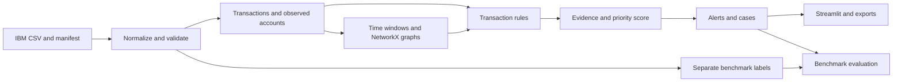

# FinTrace

An explainable suspicious-transaction and potential money-mule investigation project using IBM's synthetic AML banking benchmark.

**Status: the data provenance foundation is implemented; detection, normalization, persistence, reports, and dashboard features remain pending.** The runnable product screen is still a scaffold status page. See [the data workflow](data/README.md) for local header/checksum verification and manifest commands.

The agreed scope uses deterministic transaction rules, historical comparisons, NetworkX graph algorithms, transparent priority scoring, and investigator review. Machine learning, fitted classifiers, learned embeddings, and generated explanations are excluded.

## Dataset

Start with the **HI-Small** transaction file from [IBM Transactions for Anti Money Laundering](https://www.kaggle.com/datasets/ealtman2019/ibm-transactions-for-anti-money-laundering-aml), linked by the [IBM AML-Data repository](https://github.com/IBM/AML-Data). IBM states that the transactions are fully synthetic. Do not describe them as actual bank records.

Download separately into `data/raw/ibm/`; this scaffold does not download or redistribute dataset files. Record the file hash, variant, source URL, acquisition date, source terms, and timestamp interpretation before ingestion. IBM identifies the dataset license as **CDLA-Sharing-1.0**, separately from its repository's code license. Record the terms of the exact copy obtained.

The standard transaction export contains two source columns called `Account`. Resolve them by verified position, not a blind name-based rename. Preserve account and bank identifiers as strings. Use the pair `(bank_id, account_id)` as an account identity.

The transaction export does not supply verified customer identities, account opening dates, devices, IP addresses, ownership, expected income, or sanctions identities. Derive an observed account registry from transfer endpoints; keep optional customer/reference tables separate and mark unavailable fields explicitly.

## Features and availability

| Feature | Planned functionality | Inputs | Outputs | IBM-only support |
| --- | --- | --- | --- | --- |
| [Ingestion](docs/features/ingestion/README.md) | Normalize and preserve source lineage | IBM CSV, dataset manifest | Transactions, observed accounts, separate benchmark labels | Yes |
| [Validation](docs/features/validation/README.md) | Check schema, amounts, timestamps, identifiers and duplicates | Normalized batches, schema policy | Accepted rows, quarantine, quality report | Yes |
| [Transaction rules](docs/features/transaction_rules/README.md) | Pass-through, collection/dispersal, bursts, dormancy, repeated splitting | Valid transactions, historical windows, rule configuration | Findings with transaction evidence | Yes, subject to observed history |
| [Temporal graphs](docs/features/temporal_graphs/README.md) | Ordered chains, bounded cycles, coordinated groups and account relationships | Windowed transactions | Graphs, paths, cycles, group evidence | Yes |
| [Entity context](docs/features/entity_context/README.md) | Shared identifiers, customer mismatch, source/destination context | Optional independently sourced context | Context findings or explicit unavailability | Partial; most enrichment absent |
| [Priority scoring](docs/features/priority_scoring/README.md) | Add capped, auditable rule contributions | Findings, scoring policy | 0–100 priority and contribution breakdown | Yes |
| [Alerts](docs/features/alerts/README.md) | Deduplicate findings into reviewable alerts | Findings, scores, prior alerts | Alert queue and lifecycle events | Yes |
| [Account investigation](docs/features/account_investigation/README.md) | Explain behaviour and supporting transfers | Account key, time range, evidence | Account dossier and timeline | Yes |
| [Network investigation](docs/features/network_investigation/README.md) | Explore directed transaction neighbourhoods | Seed account or alert, graph limits | Interactive view and graph export | Yes |
| [Cases](docs/features/cases/README.md) | Group alerts, record review and maintain audit history | Alerts, investigator actions | Cases, notes, status history | Yes |
| [Reports](docs/features/reporting/README.md) | Export evidence and deterministic explanations | Case/alert snapshot | CSV, JSON, HTML and PNG artifacts | Yes |
| [Evaluation](docs/features/evaluation/README.md) | Measure rule coverage and alert usefulness against benchmark labels | Frozen detections, separately stored labels | Precision/recall, coverage and review-budget metrics | Yes; labels concern laundering, not confirmed mules |
| [Replay](docs/features/replay/README.md) | Process transaction events chronologically | Valid transactions, replay policy | Incremental findings, alerts and replay checkpoints | Yes; historical replay |
| [Screening](docs/features/screening/README.md) | Optional reference-list candidate matching | Entity identities, dated reference lists | Review candidates and exact match evidence | Disabled without additional data |
| [Dashboard](docs/features/dashboard/README.md) | Overview, queue, investigations, cases and exports | Service read models | Streamlit investigation screens | Planned |

Rules, defaults, limitations, function contracts, and acceptance examples are detailed in the linked feature specifications. Every project directory contains an `AGENTS.md` describing its purpose, inputs, outputs, functionality, and implementation constraints.

## Repository layout

```text
FinTrace/
├── AGENTS.md                     # Project-wide implementation instructions
├── README.md
├── pyproject.toml                # Dependencies and package metadata
├── app/                          # Streamlit entry point, pages and UI components
├── config/                       # TOML application, detection and scoring policies
├── data/
│   ├── raw/ibm/                  # Locally acquired immutable source files
│   ├── processed/                # Normalized transactions and derived evidence
│   └── reference/                # Optional verified context and reference lists
├── docs/
│   ├── architecture.md
│   ├── data_contracts.md
│   ├── roadmap.md
│   ├── dataset.md
│   └── features/                 # One contract directory per feature
├── outputs/                      # Local reports and exported graph artifacts
├── scripts/                      # Scaffold verification and future operational tools
├── src/fintrace/
│   ├── contracts.py
│   ├── pipeline.py
│   ├── ingestion/
│   ├── validation/
│   ├── rules/
│   ├── graph/
│   ├── context/
│   ├── scoring/
│   ├── alerts/
│   ├── investigations/
│   ├── cases/
│   ├── reporting/
│   ├── evaluation/
│   ├── replay/
│   ├── screening/
│   └── storage/
└── tests/
    ├── unit/
    ├── integration/
    └── fixtures/
```

Each listed directory also contains its own `AGENTS.md`; these files are omitted from the tree for readability.

## Planned data flow



Labels and benchmark pattern annotations are evaluation inputs only. They must never influence detection, graph construction, scoring, prioritization, or ordinary investigation screens.

## Local setup

Requires Python 3.11 or newer. These are setup instructions; dependencies have not been installed by this scaffold.

```bash
python3 -m venv .venv
source .venv/bin/activate
python -m pip install -e '.[dev]'
python scripts/check_scaffold.py
streamlit run app/streamlit_app.py
```

The Streamlit command opens a status page only. The data provenance CLI is available as `python3 scripts/prepare_data.py --help` and requires no installed application dependencies. There is no working detection CLI yet.

Core libraries: Pandas, NetworkX, Matplotlib, Streamlit, DuckDB, PyArrow and PyVis. Pytest is reserved for implementation verification. TOML is read with the Python standard library.

## Detection and explanation principles

- Findings indicate patterns warranting review; they do not establish criminal intent or a confirmed mule identity.
- Time-respecting paths require ordered transfers; structural reachability alone does not establish money movement.
- Pass-through attribution uses a declared allocation method and cannot establish exact provenance through commingled funds.
- Compare and aggregate amounts within a currency. Cross-currency value comparisons require dated conversion data and explicit policy.
- Use fixed-precision amounts; preserve timestamp precision and declared timezone assumptions.
- Separate observed inactivity from verified account dormancy and verified account age.
- Optional inputs missing from IBM must remain unavailable; do not invent customer records.
- All thresholds are demonstration policy, not reporting obligations. No automated account blocking or regulatory filing.
- Every finding and score must include source transaction references, policy versions, time windows and limitations.
- Partial graph searches, truncated displays and insufficient history must be visible.

## Next implementation work

Follow [the roadmap](docs/roadmap.md): ingestion and validation first, then deterministic rules and temporal graph detection, scoring and alerts, storage and investigations, dashboard and reports, replay and benchmark evaluation. Optional enrichment and screening follow only when suitable data is available.
